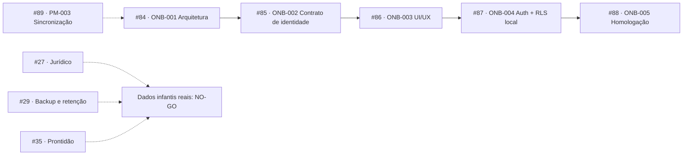

# ONB-ROADMAP | Planejamento de onboarding adulto e acolhimento

**Baseline:** 25/11/2026. **Owner:** @creusiobd. **GitHub Project existente:** https://github.com/users/creusiobd/projects/4

**Épico:** [ONB-000 #83](https://github.com/creusiobd/Mundelo---Compreens-o-Infantil/issues/83)

**Estado da sincronização nativa:** `PENDENTE`. A integração de GitHub disponível criou as issues, mas não permite editar itens/campos de GitHub Projects nem criar milestones nativas. A [PM-003 #89](https://github.com/creusiobd/Mundelo---Compreens-o-Infantil/issues/89) registra a conciliação necessária, sem assumir conclusão por esta documentação.

## 1. Milestone proposta

**M05 | Onboarding adulto e jornada de acolhimento**, nova e separada de M00–M04. Sem data de vencimento irrevogável; objetivo de janela de homologação sintética até SP05, condicionado às evidências e disponibilidade real. **Não associar temporariamente as issues às milestones anteriores**, pois isso distorceria histórico e medições.

**Definição de conclusão da M05:** ONB-001…ONB-005 com critérios demonstrados; segurança/UX sintética verificadas; autoridade profissional não concedida por autodeclaração; documentação e rastreabilidade concluídas; parecer de avanço delimitado. Milestone não significa lançamento nem permissão para dados infantis reais.

## 2. Backlog programado (não execução)

| Ref | Issue GitHub | Prioridade | Sprint planejada | Prerrequisito | Estado documental |
|---|---|---|---|---|---|
| Épico | [#83](https://github.com/creusiobd/Mundelo---Compreens-o-Infantil/issues/83) | P0 | SP02–SP05 | — | Todo |
| ONB-001 | [#84](https://github.com/creusiobd/Mundelo---Compreens-o-Infantil/issues/84) | P0 | SP02, 29/11–12/12 | ADR-005, plano v0.1 | Todo |
| ONB-002 | [#85](https://github.com/creusiobd/Mundelo---Compreens-o-Infantil/issues/85) | P0 | SP02, 29/11–12/12 | ONB-001 | Todo |
| ONB-003 | [#86](https://github.com/creusiobd/Mundelo---Compreens-o-Infantil/issues/86) | P0 | SP03, 13/12–26/12 | ONB-001, ONB-002 | Todo |
| ONB-004 | [#87](https://github.com/creusiobd/Mundelo---Compreens-o-Infantil/issues/87) | P0 | **SP04 proposta**, 27/12–09/01 | ONB-002, ONB-003 | Todo |
| ONB-005 | [#88](https://github.com/creusiobd/Mundelo---Compreens-o-Infantil/issues/88) | P0 | **SP05 proposta**, 10/01–23/01 | ONB-003, ONB-004 | Todo |
| PM-003 | [#89](https://github.com/creusiobd/Mundelo---Compreens-o-Infantil/issues/89) | P0 | SP01 encerramento e SP02 | Issues existentes + acesso Projects | Todo |

SP01 (15/11–28/11), SP02 (29/11–12/12) e SP03 (13/12–26/12) já eram previstos pela gestão; **SP04 e SP05 são propostas novas e exigem criação/associação no Project**. Datas não atribuem execução retroativa. A regra de **no máximo uma issue em execução** continua válida. ONB-001 é a primeira candidata quando sua vez chegar, não há implementação iniciada aqui.

## 3. Dependências e caminho crítico

Cuidado: a entrega de ONB-005 **não fecha** #27, #29 ou #35. A jornada adulta sintética não autoriza cadastro de crianças, documentação clínica real ou acesso profissional implícito.

## 4. Campos e visualizações que o GitHub Project deve conter

| Campo | Uso / preenchimento |
|---|---|
| Status | `Todo`, `Pronto`, `In progress`, `Bloqueado`, `Em revisão`, `Done`, como já previsto em `processo.md` |
| Iteration/Sprint | SP02, SP03 e, após verificação de ciclos, SP04, SP05 |
| Priority | P0 para ONB e PM-003; ajuste somente com decisão registrada |
| Milestone | M05 nativa após criação, sem confundir com campo customizado |
| Parent/Epic | #83 em títulos, descrições e, se disponível, relação nativa de subissues |
| Dependências | #84 → #85 → #86 → #87 → #88, confirmadas pelas issues |
| Owner | @creusiobd, somente se a associação da issue for aceita pelo GitHub |
| Área | Onboarding/Família, Identidade, UX, Segurança, QA, Gestão, se campo disponível |

As visualizações desejadas são **Board por Status**, **Table por Iteration + Priority** e **Roadmap por sprint/milestone**. Não declarar criadas ou atualizadas sem prova na interface do Project.

## 5. Métricas operacionais e baseline

| Métrica | Fórmula | Inicial 25/11 | Alvo / interpretação |
|---|---|---:|---|
| Conclusão das entregas | ONB-001…005 fechadas com evidência / 5 | **0/5 (0%)** | 5/5 somente com aceite comprovado |
| Tasks de planejamento registradas | issues #83…#89 criadas / 7 | **7/7** | Mede inventário, não entrega do produto |
| Sincronização do Project | itens verificados no Project / 7 | **Não verificado** | 7/7 após PM-003 |
| WIP (Em andamento) | Quantidade em `In progress` | 0 neste plano | Máximo 1 |
| Bloqueios críticos | Gates externos ainda não aprovados | **#27, #29, #35** | Não alterar por suposição |
| Qualidade | PASS / (PASS + FAIL) por suíte, com BLOCKED/NOT_EXECUTED separados | Sem execução ONB | Evidência e SHA em cada issue |
| Planejado vs. feito | Tarefas com aceite real / planejadas da sprint | 0 / 0 executadas agora | Sem transportar incompletos como Done |
| Cycle time | Data de conclusão - início efetivo | A medir | Não substituir por tempo desde criação |
| Lead time | Data de fechamento - criação | A medir | Visível após encerramento |

**Checkpoints:** semanal manual, no encerramento de cada sprint, via [PM-002 #36](https://github.com/creusiobd/Mundelo---Compreens-o-Infantil/issues/36). Registrar estado, PR, evidências, decisões, impedimentos e próxima ação. Não prometer automação ou sincronização de campos nativos sem ferramenta.

## 6. Operação de sincronização PM-003

1. Abrir [Project #4](https://github.com/users/creusiobd/projects/4), confirmar campos e iterations existentes.
2. Abrir [milestones do repositório](https://github.com/creusiobd/Mundelo---Compreens-o-Infantil/milestones) e criar **M05 — Onboarding adulto e jornada de acolhimento**, inicialmente sem due date obrigatório.
3. Relacionar #83–#89 à milestone, adicionar todas as issues ao Project e registrar cada status `Todo`; atribuir owner, prioridade e sprint correspondente. Não mover itens para `Done` por apenas criá-los.
4. Conferir o plano nas visualizações Board, Table e Roadmap e registrar resultado/links na [PM-003 #89](https://github.com/creusiobd/Mundelo---Compreens-o-Infantil/issues/89).
5. Fechar PM-003 somente após evidência da sincronização; então revisar no Project se ONB-001 é a única candidata `Pronto`.

## 7. Fonte normativa reutilizada

- [Plano v0.1 do onboarding familiar](../public-family-onboarding-implementation-plan-v0.1.md)
- [ADR-005 identidade e Supabase](../adr/005-identidade-e-persistencia-supabase.md)
- [Processo de gestão e WIP](processo.md)
- [Backlog histórico](backlog.md)
- [Sprints históricos](sprints.md)
- [Marcos históricos](marcos-entregas.md)

O registro presente é uma **extensão datada** do planejamento histórico, sem sobrescrever sua fotografia passada ou o estado real do GitHub Project.
