# ONB-001 — Arquitetura de onboarding e jornada de acolhimento v1.0

Data: 25/11/2026. Responsável: Creusio Kizua (@creusiobd). Issue: [#84](https://github.com/creusiobd/Mundelo---Compreens-o-Infantil/issues/84). Épico: [#83](https://github.com/creusiobd/Mundelo---Compreens-o-Infantil/issues/83). Marco: M05.

**Estado: proposta entregue para revisão documental.** Não implementa Auth, migrações, telas ou hospedagem. Aprovação e incorporação ainda precisam ser registradas. Não constitui aprovação jurídica ou verificação humana independente.

## 1. Resultado e fronteira da entrega

Desenhar a passagem da demonstração sintética para uma conta adulta e uma área de acolhimento sem dados infantis. O cadastro público adulto é uma direção de produto do ADR-005; a execução das tarefas ONB permanece em ambiente local isolado e com identidades sintéticas. Uma conta adulta não comprova parentesco, responsabilidade legal, habilitação profissional, vínculo ou autorização sobre uma criança.

Inclui primeira entrada, escolha de jornada, cadastro, confirmação, login/logout, recuperação, expiração, abandono/retomada, aceites e primeiro acesso. O ramo profissional informa limites e termina sem acesso a famílias. Convites, validação profissional, compartilhamento, cadastro infantil, anexos, diagnóstico e IA sobre famílias ficam fora desta entrega. A demonstração existente não será migrada para contas autenticadas.

Artefatos complementares: [jornadas e estados](jornadas-v1.md), [critérios e gates](criterios-v1.md), [inventário das fontes](fontes-v1.json). Nenhum princípio INF-ID é criado, reformulado ou elevado a canônico por este desenho.

## 2. Base conferida e conciliação

Base Git examinada: `c2a8d1f6d10da13324c6a0b7de21da87068f9345`. Os caminhos e blobs estão no inventário de fontes; descrições abaixo resultam de leitura estática, não de novo ensaio funcional.

| Fonte | Estado observado / decisão existente | Aplicação no desenho |
|---|---|---|
| [ADR-005](../adr/005-identidade-e-persistencia-supabase.md), §§2–7 e 13 | Supabase; SPA/SDK + PKCE para desenvolvimento; sessão de produção e hospedagem condicionais | Manter decisão, SDK isolado e G0 separado de G1–G5; pluralidade das perspectivas preservada |
| [Plano v0.1](../public-family-onboarding-implementation-plan-v0.1.md), §§3–9 | Cadastro adulto e espaço mínimo; sem dados infantis; modelo conceitual sujeito a revisão | Detalhar estados; criação idempotente após confirmação; schema final em #85/#87 |
| [Ameaças v0.1](../threat-model-public-family-onboarding-v0.1.md), T-01–T-10 | Isolamento, segredos, sessão, enumeração, abuso, minimização, aceites, exclusão, XSS, operação | Matriz de critérios liga cada ameaça ao teste e ao responsável pela evidência |
| [WelcomeScreen](../../src/screens/WelcomeScreen.tsx) | CTA Explorar Início e Configurar Perfil Demonstrativo; destinos do protótipo | Não redirecionar o adulto autenticado ao perfil demonstrativo como se fosse sua família |
| [OnboardingScreen](../../src/screens/OnboardingScreen.tsx) | Perfil Demonstrativo da Criança; nome fictício, idade, pronome, interesses/conforto/comunicação; guardas client-side | Preservar como demonstração isolada; criar fluxo adulto próprio em #86 |
| [App](../../src/App.tsx) e [AppContext](../../src/context/AppContext.tsx) | ScreenId/setScreen e estado demonstrativo; tela inicial `home`; labs DEV | Propor shell adulto separado; estado React e cuidador sintético não autenticam ninguém |
| [Autorização demonstrativa](../../src/security/authorization.ts) | Regras locais para perfis/observações e papel LEGAL_GUARDIAN no protótipo | Não copiar privilégios de edição/exclusão para a conta adulta |
| [Contrato persistente](../../src/domain/persistentAccessContract.ts) | Contrato puro, sem identidade ou RLS implementadas; autoridade verificada e concessões por operação/versão | Autenticação não cria Grant; desenho adulto não preenche authorityVerified nem concede acesso infantil |
| [Contrato de perspectivas](../contratos/contribuicoes-perspectivas/contrato.md), PC-02/08/10/13/15/16 | Autoria, vínculo, competência, autorização e verdade separados; retenção proporcional | Escolha familiar/profissional é preferência de jornada; não altera autoridade nem autoria de fontes |
| [Roadmap ONB](../gestao/onboarding-roadmap-2026-11.md) e [processo](../gestao/processo.md) | Entregas sequenciais e WIP 1 | #84 entrega arquitetura; #85 contrato; #86 UI; #87 Auth/RLS local; #88 homologação |

O plano de 17/11 relata ausência de infraestrutura naquele momento; não deve ser lido como inventário atual. Os laboratórios SQL/API já existentes no repositório são evidências de seus próprios recortes; não demonstram onboarding adulto implementado. `package.json` da base não declara `@supabase/supabase-js`; nada é instalado nesta tarefa. Não atualizar SDK/CLI ou alterar pipelines incidentalmente.

## 3. Componentes e fronteiras de confiança

```mermaid
flowchart LR
  V["Visitante / navegador não confiável"] --> P["Shell público e demonstração sintética isolada"]
  P --> U["UI adulta: cadastro, login, recuperação"]
  U --> S["Adaptador Auth: SDK oficial, PKCE"]
  S --> A["Supabase Auth local de teste"]
  A --> C["Callback validado / estado de sessão"]
  C --> B["Inicialização idempotente autorizada"]
  B --> D["API e Postgres: grants, RLS, constraints"]
  D --> W["Área adulta vazia / acolhimento"]
  W --> X["Dados infantis e colaboração: bloqueados"]
```

Diagrama proposto; nenhuma seta comprova integração existente.

| Componente proposto | Responsabilidade | Não pode decidir |
|---|---|---|
| Shell público | Explicar finalidade e limites; entrar na demonstração por ação explícita | Identidade ou vínculo a partir de um perfil sintético |
| AdultOnboarding / SessionBoundary | Apresentar estados, mensagens, foco e retomada segura | Autorizar CRUD por guardas de rota |
| AuthAdapter | Encapsular SDK oficial; troca PKCE, eventos de sessão, login/logout/recuperação | Criar armazenamento artesanal de tokens ou emitir papel privilegiado |
| AccountBootstrap | Operação confiável, atômica/idempotente, para conta confirmada e aceites atuais | Aceitar owner/user_id/role definidos pelo cliente |
| API/Postgres | Verificar identidade e sessão conforme política, membership vigente, RLS/grants/constraints | Confiar em `user_metadata`, React, e-mail informado ou JWT desatualizado para autoridade |
| DemoBoundary | Instância/contexto demonstrativo independente, com dados sintéticos | Importar o cofre ou atribuir os cuidadores de demonstração à conta real |

Separar `authState`, `onboardingState` e `authorizationState`. Uma sessão presente não implica e-mail confirmado; confirmação não implica bootstrap concluído; bootstrap não implica acesso infantil. Consultas iniciadas sob uma identidade carregam geração de sessão/contexto: ao trocar de conta ou encerrar sessão, abortar requisições e descartar respostas atrasadas antes de exibir/confirmar efeitos. A checagem confiável no servidor continua obrigatória.

### Fronteiras e operações

1. Navegador → Auth: e-mail/senha apenas para o provedor; callbacks em origens e caminhos permitidos, sem open redirect. Não registrar query/fragmento de callback nem URL de recuperação. PKCE depende do verifier do dispositivo que iniciou o fluxo; link em outro navegador deve orientar reinício seguro, sem contornar a verificação.
2. Auth → aplicação: consumir identidade confirmada; o callback não aceita `role`, `family_id`, `next` arbitrário ou flags de autorização. Remover parâmetros sensíveis da URL após processamento. Falha/replay/expiração levam ao estado recuperável, sem liberar área privada.
3. Aplicação → dados: grants e RLS por operação, usuário e membership vigente; usuário anônimo, conta não confirmada, membership ausente/revogada e conta B não acessam o espaço A. Ownership e campos administrativos não são editáveis pelo cliente. `TO authenticated` sozinho é insuficiente; funções privilegiadas exigem revisão específica.
4. Operação administrativa: credenciais apenas em processo confiável; nenhuma chave privilegiada em `VITE_*`, bundle ou logs. Não criar tabela/bucket infantil nesta frente. RLS em dados de conta não comprova conformidade legal.

## 4. Dados mínimos por finalidade

Schema abaixo é conceitual, a fechar em #85 antes de migrations em #87. Laboratório usa contas A/B sintéticas e caixa de e-mail local. O nome de exibição do ADR é um apelido adulto, não exige nome civil nem nome da criança.

| Dado | Finalidade e destino | Restrição e ciclo de vida |
|---|---|---|
| E-mail adulto | Verificação, login e recuperação em Auth | Não duplicar em telemetria, URLs ou tabelas de perfil sem necessidade; retenção/exclusão em decisão operacional |
| Senha / verifier / tokens | Autenticação, geridos pelo SDK/Auth | Não copiar em tabelas, rascunhos, logs ou evidências; rascunho de senha nunca persistido |
| ID de Auth e apelido adulto | Perfil mínimo próprio | ID é dado pessoal, não sinal de autoridade; corrigível pelo fluxo de conta permitido |
| Preferência familiar/profissional | Adaptar conteúdo da jornada | Enum fechado, opcional, em memória inicialmente; sem criar claim, membership ou concessão |
| IDs de espaço e membership | Isolamento do espaço do criador confirmado | Criados pelo caminho confiável, com unicidade/idempotência; papel técnico de espaço não prova guarda |
| Tipo/versão do documento, decisão e data do servidor | Demonstrar aceite afirmativo | Sem caixa pré-marcada; versão de conteúdo identificável; não confundir aceite necessário e consentimento opcional; revisão em #27 |
| Etapa de onboarding e versão do fluxo | Retomar acolhimento da própria conta | Enum mínimo, sem texto livre; acesso próprio; só persistir após identidade validada |
| Preferências opcionais | Configuração voluntária, se necessária | Separadas de aceites; recusa não bloqueia funções necessárias; não adicionar analytics nesta entrega |

Não coletar data de nascimento, CPF, conselho profissional, documentos de guarda, escola, saúde, foto, narrativa livre sobre crianças ou contatos de terceiros. Não criar prova documental de vínculo no cadastro inicial.

Não fixar duração de conservação por conveniência técnica. #85 deve relacionar cada dado de conta às categorias/finalidades da [matriz de retenção](../parametros-retencao-categorias-v0-1.md), com responsáveis e gatilhos; #27 valida fundamento, #29 comprova capacidade e #35 decide prontidão. Exclusão da conta é solicitação com protocolo e estados, não promessa de eliminação instantânea em backups. Desabilitar acesso e tratar sessões antes de concluir destinação conforme política aprovada.

## 5. Inicialização e retomada

Após identidade confirmada e aceite atual, `AccountBootstrap` deriva o sujeito da sessão confiável e prepara o perfil mínimo. Somente na jornada familiar explicitamente escolhida executa em transação o espaço inicial e membership do criador. No ramo profissional, prepara apenas a conta e acolhimento informativo, sem membership familiar implícita. Uma chave lógica de unicidade vinculada ao sujeito impede dois espaços iniciais em concorrência/retry; não confiar em chave fornecida para escolher owner. Persistir o resultado e retornar o mesmo recurso em repetição legítima. Falha não apresenta sucesso parcial; reconsultar estado antes de tentar novamente.

O profissional, nesta versão proposta, pode conhecer o produto e usar uma conta adulta genérica de teste sem privilégios especiais; termina em acolhimento informativo sem diretório de famílias, busca infantil, convite, atendimento ou acesso profissional. Criar perfil profissional ou coletar comprovações exige decisão separada. A mesma pessoa pode depois optar pela jornada familiar, sem transferir poderes entre jornadas.

Retomada anônima restaura no máximo etapa/preferência em memória; recarregar a página volta à entrada sem recuperar senha/e-mail preenchido. Após autenticar, recuperar apenas etapa da própria conta. Não transportar rascunho ou promessa de retorno entre contas. Destino pós-login vem de enum interno autorizado; deep link privado não se torna autorização. Cancelar não cria conta/espaço implicitamente.

## 6. Eventos e métricas

Proposta de instrumentação para ensaio local; nenhum SDK analítico adicionado. Contadores agregados por lote sintético: `entry_shown`, `signup_attempt`, `verification_pending`, `verified`, `login_result`, `recovery_requested`, `bootstrap_result`, `welcome_reached`, `session_ended`. Campos permitidos: versão do fluxo, identificador do cenário sintético, etapa enum, resultado enum e faixa de duração. Não usar IDs de pessoa/família/sessão, e-mail, texto livre, URL, IP, user agent ou tokens. Mensagem bruta de erro do provedor nunca vira evento.

| Métrica de ensaio | Denominador | Interpretação |
|---|---|---|
| Conclusão | Execuções que chegaram ao acolhimento / execuções iniciadas do mesmo cenário | Não mede famílias reais nem qualidade do vínculo |
| Falha por etapa | Execuções com falha / tentativas daquela etapa | Separar erro técnico, negação esperada e cancelamento |
| Retomada | Retomadas bem-sucedidas / cenários de interrupção executados | Sem rastreamento persistente do visitante |
| Tempo | Duração de etapas nos ensaios sintéticos | E-mail externo e pausas humanas separados; nenhum SLA aprovado |

Sem execução: apresentar NOT_EXECUTED e denominador planejado; não inventar taxa, zero sucesso ou abandono humano. Descartar eventos brutos de ensaio após consolidar evidência mínima da execução, sob procedimento do laboratório; duração operacional de logs em produção continua pendente e bloqueia liberação.

## 7. Acessibilidade e acolhimento

Meta de implementação: WCAG 2.2 AA. Texto direto, sem pressão para cadastrar criança e sem promessa diagnóstica. Ordem de leitura previsível, h1 único por etapa, rótulos persistentes, autocomplete apropriado, instrução de senha antes do envio e possibilidade de colar/usar gerenciador. Erros associados ao campo e resumo focável após submissão; regiões de status anunciam carregamento/sucesso sem expor dados ou mover foco repetidamente.

Teclado integral, foco visível e não encoberto, retorno ao disparador ao fechar diálogo, botões com nome acessível, contraste e alternativa a movimento. Não depender de cor, ícone ou contagem regressiva para comunicar estado. Alvos preferencialmente 44×44 CSS px; testar reflow a 320 CSS px, zoom 200% e faixa 320–1440 px. Erro de confirmação deve oferecer reenviar/voltar; bloqueio profissional informa o limite e um caminho de saída. Leitor de tela e dispositivo real exigem protocolo humano registrado, não apenas axe.

## 8. Decisões e alternativas para revisão

Todas as linhas são propostas desta arquitetura, salvo a decisão do ADR citada; responsável por aceitar/rejeitar: Creusio Kizua. Revisão independente de segurança/privacidade: pessoa a designar quando exigida pelo gate.

| ID | Questão / alternativas | Proposta ou pendência e condição |
|---|---|---|
| ONB-D01 | Reaproveitar formulário infantil ou separar shell adulto | Separar; evita equivalência falsa e mantém regressões do protótipo |
| ONB-D02 | SPA + SDK/PKCE ou BFF/cookies | Manter SPA para laboratório conforme ADR; produção pendente de risco/hosting/CSP; BFF não aprovado automaticamente |
| ONB-D03 | Família/profissão como papel de acesso ou preferência | Apenas preferência; concessões dependem de validação confiável própria |
| ONB-D04 | Criar espaço no formulário, trigger genérico ou operação explícita | Operação explícita idempotente após confirmação/aceite; #85 define transação e políticas antes de #87 |
| ONB-D05 | Retomar tudo em localStorage ou estado mínimo | Sem persistir rascunho sensível; etapa própria autenticada apenas; #85 define logout, revogação e TTL conforme risco |
| ONB-D06 | Permitir área profissional ou acolhimento sem poderes | Apenas informativo; validação profissional e vínculos ficam fora de M05 |
| ONB-D07 | Coletar analytics identificável ou ensaio agregado | Somente ensaio sintético agregado; telemetria de produção exige finalidade e retenção aprovadas |
| ONB-D08 | Publicar adulto ao concluir G0 ou aguardar G1–G4 | Aguardar evidências de identidade, isolamento, UX, privacidade e operação; #27/#29/#35 mantidos |

Pendências de produção: hospedagem/região, sessão e revogação efetiva, CSP/origens/redirects, SMTP e antiabuso, textos legais/versionamento, retenção/destinação e resposta a incidentes. Não fixar parâmetros de senha, token, prazo de conta ou fundamento jurídico sem a decisão correspondente em #85/#27. Acesso estrito após revogação não pode depender apenas de expirar JWT; #85 precisa definir e #87 testar a verificação confiável adequada.

## 9. Entrega, revisão e sequência

G0 documental: revisar conciliação, percorrer as duas jornadas e aprovar/rejeitar ONB-D01–08 com comentário e SHA da PR. Autor verifica links/cobertura; isso não conta como revisão humana independente. #84 permanece aberta e Em revisão até aprovação conceitual e incorporação. CI verde comprova regressões/configuração da PR, não Auth funcional, consentimento válido ou produção pronta.

#85 define contrato e parâmetros; #86 implementa UI sintética com estados de falha; #87 integra Auth/RLS somente no laboratório local; #88 executa homologação. Os critérios funcionais do arquivo complementar são NOT_EXECUTED nesta tarefa. M05/épico e gates externos permanecem abertos.

## 10. Referências técnicas consultadas em 25/11/2026

- [Supabase PKCE](https://supabase.com/docs/guides/auth/sessions/pkce-flow): código de uso único, verifier e limitações entre navegadores.
- [Sessões](https://supabase.com/docs/guides/auth/sessions): renovação do SDK e limites da invalidação de JWT.
- [RLS](https://supabase.com/docs/guides/database/postgres/row-level-security): grants e políticas são controles complementares.
- [Changelog](https://supabase.com/changelog.md) e [CLI v3](https://supabase.com/changelog/supabase-cli-v3): mudanças de targeting/flags; não atualizar incidentalmente o laboratório existente.

Essas referências sustentam premissas técnicas; não comprovam configuração do projeto. Novas versões deverão ser verificadas em #85/#87 antes de codificar.
