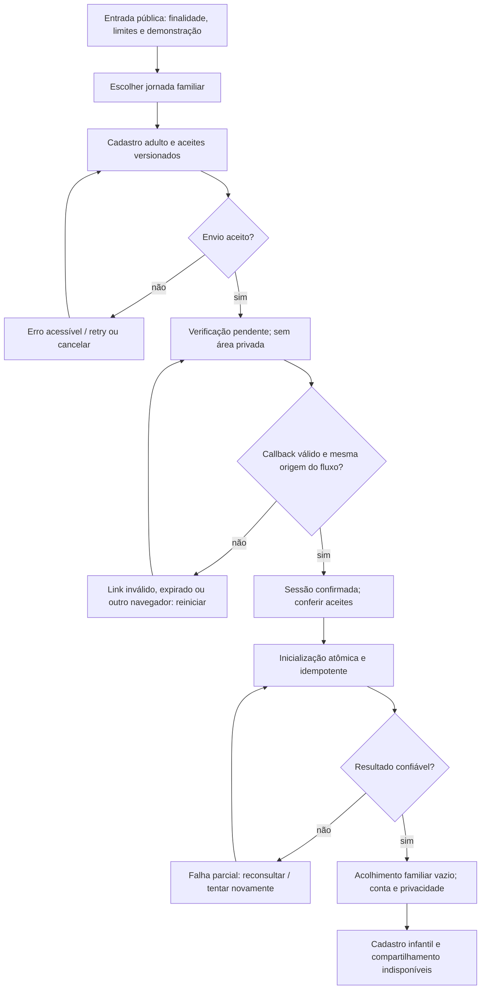
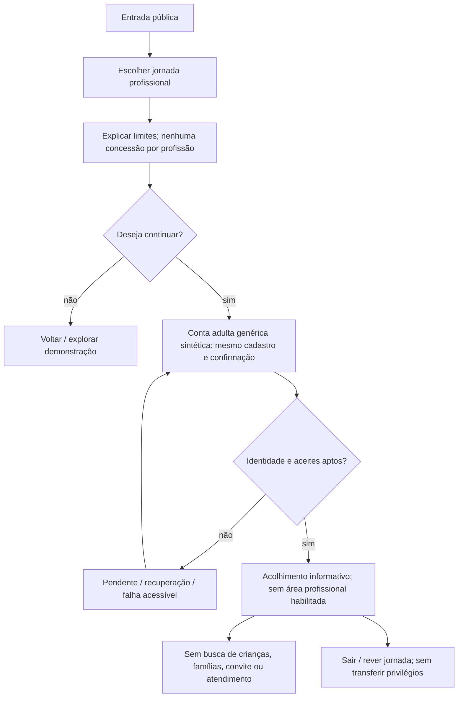

# ONB-001 — Jornadas e estados v1.0

Proposta para revisão em 25/11/2026. Documento principal: [arquitetura](arquitetura-v1.md). As rotas abaixo são nomes lógicos propostos, não rotas implementadas. Asserções verificáveis: [critérios](criterios-v1.md).

## Jornada familiar

Em toda etapa, cancelar/voltar é permitido sem penalizar a pessoa. Visitante pode explorar demonstração sintética sem criar conta. Login existente entra pela conferência de sessão/aceites, sem repetir cadastro nem criar outro espaço. A confirmação pode exigir login explícito após o callback conforme o contrato de #85; não presumir sessão autenticada apenas porque o link foi aberto.

## Jornada profissional

Não coletar número de conselho ou documentos profissionais para uma função indisponível. Não exibir “profissional verificado”. Se o adulto também quiser uma área familiar, deve optar por essa jornada explicitamente e cumprir os mesmos requisitos de conta; isso não comprova guarda. No ramo profissional, bootstrap de conta não cria membership familiar por autodeclaração; o bootstrap familiar só ocorre após opção explícita pela jornada familiar. Decisão final em ONB-D06/#85.

## Máquina de estados proposta

Estados de UI não substituem estados confiáveis de Auth/DB. Após recarregar, reconstituir sessão pelo SDK e consultar dados próprios; nunca restaurar autorização de cache da UI. `confirmed` e `active` abaixo precisam de verificação confiável antes de qualquer operação protegida.

| Estado | Tela / evento de entrada | Saída e guarda | Falha ou cancelamento |
|---|---|---|---|
| PUBLIC_ENTRY | Primeira visita ou logout concluído | Escolha explícita → JOURNEY_CHOICE ou DEMO | Sem seleção automática de perfil da demonstração |
| DEMO | Exploração voluntária | Voltar à entrada; sair da demonstração limpa contexto | Nenhum caregiver sintético se torna identidade Auth |
| JOURNEY_CHOICE | Familiar/profissional/voltar | Preferência enum → ADULT_SIGNUP ou LOGIN | Preferência opcional; não altera autorização |
| ADULT_SIGNUP | Apelido, e-mail, senha e aceites | Formulário válido → SUBMITTING | Erro por campo; cancelar elimina rascunho sensível |
| SUBMITTING | Requisição em curso | Resultado admissível → EMAIL_PENDING | Desabilitar envio duplicado; timeout → RETRYABLE_ERROR; reconsultar antes de retry |
| EMAIL_PENDING | Confirmação ainda ausente | Callback → CALLBACK_CHECK; login confirmado pode continuar | Mensagem genérica; reenviar com limites; voltar ao login |
| CALLBACK_CHECK | Código/erro retornado em origem permitida | SDK valida troca/identidade → SESSION_CHECK | Expirado, reutilizado, verifier ausente ou origem inválida → LINK_ERROR; remover parâmetros sensíveis |
| LINK_ERROR | Falha de confirmação/recuperação | Reiniciar fluxo no navegador original ou solicitar novo link | Não trocar manualmente identidade; não liberar área |
| LOGIN | E-mail e senha | SDK autentica → SESSION_CHECK | Resposta genérica, rate limit e recuperação; preservar só campos não sensíveis em memória |
| SESSION_CHECK | Inicialização, retorno de aba ou token renovado | Sessão válida, conta confirmada → ACCEPTANCE_CHECK | Sem sessão → LOGIN; não confirmada → EMAIL_PENDING; rede incerta → acesso protegido suspenso |
| ACCEPTANCE_CHECK | Conferir versões necessárias | Aceite atual → BOOTSTRAP_PENDING; novo aceite afirmativo se necessário | Recusa → saída sem criar espaço; opcional não bloqueia funções necessárias |
| BOOTSTRAP_PENDING | Perfil mínimo / espaço familiar se aplicável | Transação idempotente própria → WELCOME_FAMILY ou WELCOME_PRO_INFO | Retry consulta estado atual; membership negada → ACCESS_BLOCKED |
| WELCOME_FAMILY | Conta e espaço próprios confirmados | Acolhimento, privacidade, logout | Sem formulário infantil, convites, conteúdo de outra família ou dados da demo |
| WELCOME_PRO_INFO | Conta própria, preferência profissional | Conteúdo informativo, privacidade, logout | Função profissional não habilitada; sem concessão automática |
| RECOVERY_REQUEST | Solicitar redefinição | Resposta genérica → RECOVERY_WAIT | Conta existente/inexistente indistinguível na mensagem; limitar abuso |
| RECOVERY_WAIT | Orientação para consultar caixa local | Callback válido → RESET_PASSWORD | Novo pedido ou cancelamento; sem inferir existência de conta |
| RESET_PASSWORD | Sessão de recuperação validada | Atualização aceita → novo login conforme política de #85 | Link expirado/replay → LINK_ERROR; senha nunca em rascunho/log |
| SESSION_EXPIRED | Expiração, refresh negado ou revogação identificada | Limpar UI/cache/requisições → LOGIN | Não renderizar dados anteriores; descartar respostas atrasadas |
| ACCESS_BLOCKED | Identidade sem autorização ou membership revogada | Explicar limite; voltar/sair; recuperação de acesso futura | Não sugerir mudar papel como forma de liberar acesso |
| RETRYABLE_ERROR | Rede/servidor indisponível | Retry idempotente ou cancelar | Sem sucesso presumido e sem reenvio ilimitado |
| LOGOUT_PENDING | Ação sair | Limpar estado, interromper trabalhos e encerrar sessão pelo SDK → PUBLIC_ENTRY | Falha remota: manter bloqueio local e informar limite; revogação no servidor depende do contrato |

## Regras transversais de navegação e retomada

- Deep link privado inicia SESSION_CHECK, nunca bypass de confirmação ou RLS; destino permitido vem de enum interno, não de URL livre.
- Após abandono anônimo/reload, reiniciar sem recuperar e-mail, senha ou token de query. Após login, etapa mínima da própria conta permite retomar acolhimento, nunca submissão sensível automática.
- Conta A → logout/troca → conta B: invalidar geração, caches, formulários e resposta pendente antes de carregar dados B. Não reutilizar etapa privada de A.
- Navegador/aba de confirmação diferente: explicar que o fluxo precisa ser reiniciado no contexto correto; não usar retorno arbitrário nem desativar PKCE.
- Bootstrap repetido ou concorrente retorna o mesmo espaço inicial; não multiplicar contas, memberships, aceites ou espaços por clique duplo.
- Expiração durante operação suspende efeitos no cliente e exige revalidação confiável no servidor; a exibição anterior não autoriza commit posterior.
- `Logout` não deve prometer revogação instantânea de todo JWT já emitido. #85 decide escopo de logout e checagem de sessão; #87 executa casos adversariais.
- Exclusão de conta inicia solicitação própria/protocolo; diferenciar solicitado, em análise, acesso restringido e destinação comprovada. Não anunciar eliminação de backups a partir de um botão.
